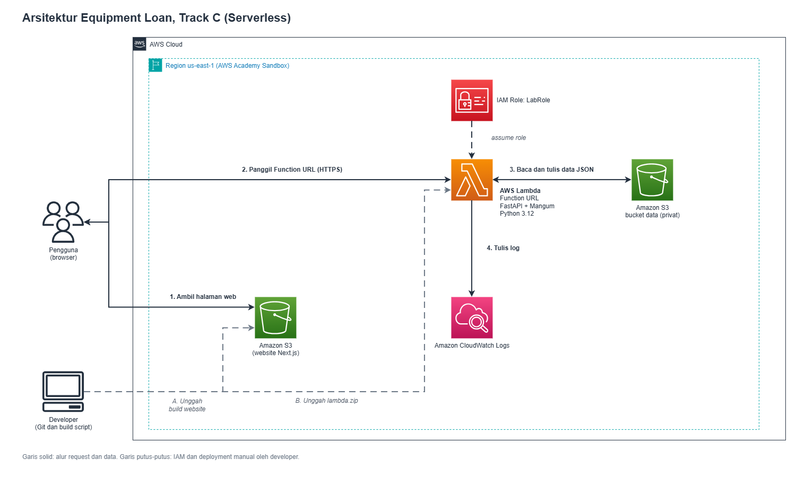

# Equipment Loan

Sistem peminjaman peralatan laboratorium berbasis web. Aplikasi ini mencatat siapa meminjam alat apa, kapan alat harus kembali, dan apakah alat sudah dikembalikan. Backend berjalan serverless di AWS sehingga tidak ada server yang perlu dikelola.

## Fitur utama

- Menambah data peminjaman
- Melihat daftar peminjaman, dengan filter status
- Mengubah data dan menandai alat yang sudah dikembalikan
- Menghapus data peminjaman

## Arsitektur



Pengguna memanggil API lewat Lambda Function URL. Request diterima oleh FastAPI yang dibungkus Mangum dan berjalan di AWS Lambda. Setiap data peminjaman disimpan sebagai satu objek JSON di bucket S3 privat, dan log request masuk ke CloudWatch Logs. Halaman web dari frontend Next.js disajikan dari bucket S3 terpisah.

## Teknologi

- Python 3.12, FastAPI, Mangum, Pydantic, boto3
- AWS Lambda, Amazon S3, Amazon CloudWatch
- Next.js dan TypeScript untuk frontend
- pytest dan moto untuk pengujian

## Struktur folder

```
equipment-loan-aws/
├── backend/        kode FastAPI, unit test, smoke test, dan build_package.py
├── frontend/       aplikasi Next.js (static export)
├── infra/          event uji untuk Lambda
├── scripts/        script bantu untuk menyiapkan ulang environment AWS
├── docs/           diagram, spesifikasi API, dan panduan deployment
└── tests/          contoh body request
```

## API

| Method | Path | Fungsi |
|---|---|---|
| POST | /loans | Menambah peminjaman |
| GET | /loans | Melihat daftar peminjaman |
| GET | /loans/{loanId} | Melihat satu peminjaman |
| PUT | /loans/{loanId} | Mengubah peminjaman |
| DELETE | /loans/{loanId} | Menghapus peminjaman |
| GET | /health | Mengecek koneksi ke penyimpanan data |

Detail request dan response ada di [docs/api-spec.md](docs/api-spec.md).

## Menjalankan test secara lokal

Test tidak membutuhkan akun AWS karena S3 ditiru dengan moto.

```
cd backend
python -m venv .venv
.venv\Scripts\activate
pip install -r requirements-dev.txt
python -m pytest
```

Di Linux atau macOS, aktifkan environment dengan `source .venv/bin/activate`.

Untuk menguji API yang sudah di-deploy:

```
python backend/tests/smoke_test.py <URL API>
```

## Deployment

Panduan deployment ada di [docs/deployment-guide.md](docs/deployment-guide.md).
